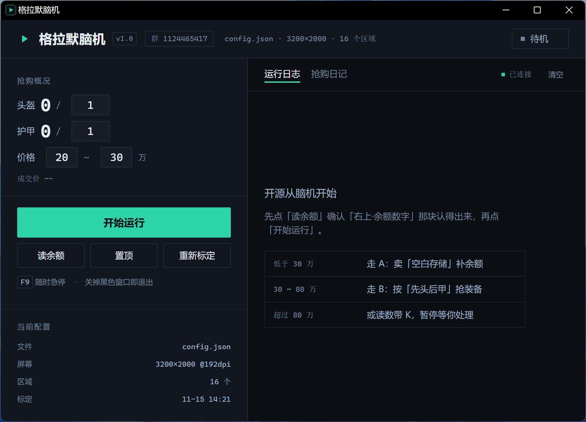
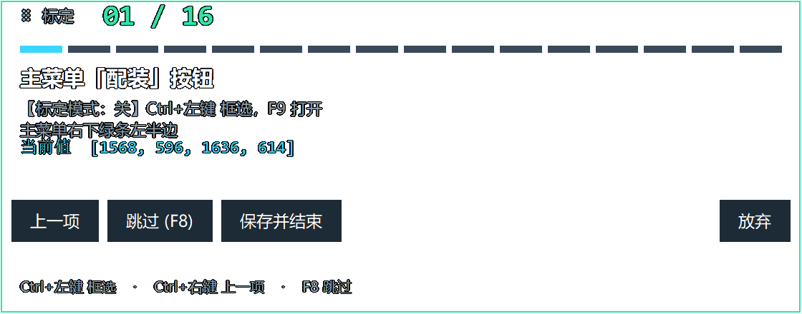

# 格拉默脑机 v1.2

> 三角洲行动 · 仓库自动抢装备工具。看一眼余额，自己决定该去卖东西补钱、还是去刷最低价。

Windows 桌面程序，WebView2 界面，纯本地运行，不联网、不上传任何数据。



## 它做什么

程序只看两个数字：**余额**和**最低价**，然后按规则做事。

| 余额 | 动作 |
| --- | --- |
| 低于 30 万 | 走 A：去仓库卖掉「空白存储」补钱 |
| 30 万 ~ 80 万 | 走 B：到交易行按「先头后甲」抢装备 |
| 超过 80 万，或读数带 K | 暂停，等人工处理 |

走 B 时它会：

1. 打开配装页，按目标槽位（头盔 / 护甲）进去
2. 把列表拖到底，盯住最下面那一行的价格
3. 往返点两个刷价点，同时高速 OCR 读价格（约 20 次/秒）
4. 一旦落进设定的价格区间，立刻停下、点回去、按 10ms 间隔连点购买按钮
5. **余额真的掉下来才算抢到**，手慢没抢到会继续刷

## 界面

两个形态，尺寸自动切，工作态常驻置顶：

| 待机（大窗） | 工作（小窗置顶） |
| --- | --- |
| 抢购概况、目标数量、价格区间、运行日志、抢购日记 | 当前最低价（大号数字）、日志 |

- **抢购概况**：头盔、护甲各一行 `已抢 / 目标`，目标数字直接改，自动记住
- **抢购日记**：每抢到一件记一行，时间、类型、成交价、第几件
- **F9**：随时急停
- **重新标定**：拖框标 16 个位置，按 **F9 切换标定模式**，开了就直接左键拖，不用按 Ctrl
- **标定的第 17 步**：框住仓库里的「空白存储」物品格，程序会把那块截图存成找同款的模板。换分辨率、换画质、换主题，重框一次就行，不用找人要图

### 标定界面



按 **F9** 在「标定模式」和普通模式之间切换：

- **标定模式开**（面板提示是绿色）：直接左键拖框，不用按 Ctrl
- **标定模式关**（灰色）：按住 Ctrl + 左键拖框

框尽量左右留宽一点——价格位数多的时候（过 100 万就是 7 位），框太窄会把最后一位切掉。标完点「保存并结束」，中途想退点「放弃」。

## 快速开始

### 方式一：下载成品（推荐）

到 [Releases](../../releases) 下载：

- `格拉默脑机_v1.1_便携版.zip` —— 解压即用，推荐
- `格拉默脑机_v1.1_安装包.exe` —— 装到本机，需要 Windows 允许运行未签名程序

首次使用：双击启动 → 点「重新标定」框一遍 16 个位置 → 点「读余额」确认认得出来 → 点「开始运行」。

> 别的电脑要装 [WebView2 Runtime](https://developer.microsoft.com/microsoft-edge/webview2/)（Win10/11 大多自带）。

### 方式二：从源码跑

```bat
pip install numpy pillow pywebview
python server\main.py
```

只想要命令行：

```bat
python auto\dvc_auto.py --probe     # 只读一次余额，不点击
python auto\dvc_auto.py --live      # 实盘
```

## 目录结构

```
auto/                  自动化核心
  dvc_auto.py          状态机：检测 → A 补钱 / B 抢购
  dvc_vision.py        模板匹配找图 + 数字 OCR（numpy 手写，无第三方 OCR）
  dvc_win.py           Win32 封装：截图、SendInput、DPI
  dvc_deps.py          依赖自检
  ocr_probe.py         OCR 验证小工具（框选区域实时看识别结果和速度）
  digits/              数字字模 87 张
  assets/              物品模板图
server/                后端
  main.py              入口：起 HTTP 服务 + pywebview 窗口
  engine.py            子进程管理、日志/价格/成交事件推送
  app_handler.py       HTTP 路由 + SSE
  window.py            原生窗口尺寸/置顶
web/                   前端（HTML + CSS + 原生 JS，无框架）
src/标定程序/           独立标定工具
build/                 PyInstaller + Inno Setup 打包配置
```

## 为什么这么写

- **数字识别自己做**：通用 OCR（tesseract）单次 50~100ms，撑不起 20 次/秒的刷价循环。这里用固定字体模板匹配，单次 1ms 左右。
- **找图用归一化互相关**：装备格选中会变亮，NCC 对整体亮度不敏感；纯色场景分母趋零需要额外屏蔽。
- **子进程隔离**：自动化逻辑跑在独立进程，界面崩了不影响正在跑的任务，也方便单独调试。
- **一个 exe 多角色**：打包后 `--run-auto` / `--run-calib` 复用同一个可执行文件，不用拆三个。

## 已知边界

- 没做掉线重连，读不到余额就暂停等人工
- 字模是按当前游戏字体采的，游戏改字体或换分辨率要重采
- 刷价没有次数上限，靠 F9 或价格命中退出
- 窗口位置不记忆，每次开在屏幕中间

## 免责声明

本项目仅供学习自动化技术（Win32 输入模拟、屏幕取字、模板匹配）。**游戏内使用自动化脚本可能违反用户协议、有封号风险，后果自负。** 作者不对任何账号损失负责。请勿用于商业代练等用途。

## 许可证

[MIT](LICENSE)

---

交流群：1124465417
